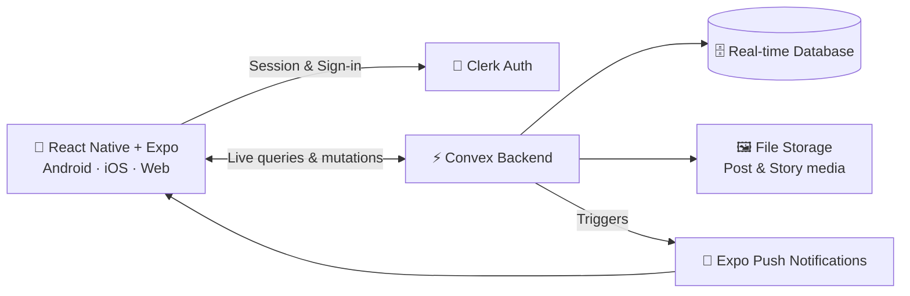

<div align="center">

<h1>💬 BENCH</h1>

<h3>Share moments. Start conversations. All in real time.</h3>

<p>
A full-stack, real-time social networking app with stories, posts, chat and push notifications,<br/>
built once with React Native & Expo and shipped to <b>Android · iOS · Web</b>.
</p>

<p>
  
  
  
  
  
  
</p>

<p>
  
  
  
  
  
</p>

<p>
  <a href="#-screenshots"><b>📸 Screenshots</b></a> ·
  <a href="#-features"><b>✨ Features</b></a> ·
  <a href="#-app-tour-12-screens"><b>🧭 App Tour</b></a> ·
  <a href="#-getting-started"><b>🚀 Get Started</b></a>
</p>

</div>

---

## 🌟 Why BENCH?

Most social apps feel like a pile of separate features. **BENCH brings them together**: scroll a live feed, drop a story, like and comment on posts and watch it update instantly on everyone's screen, then slide into a **real-time chat** with a friend. All of it comes from **one codebase**.

> ⚡ No refresh buttons. No polling. Powered by Convex, **every like, comment and message appears the moment it happens.**

---

## 📸 Screenshots

<p align="center">
  
  
  
  
  
</p>

<p align="center">
  
  
  
  
  
</p>

<p align="center">
  


</p>

---

## ✨ Features

| | Feature | What you get |
|---|---|---|
| 🔐 | **Secure Auth** | Sign up and sign in with Clerk, including one-tap **Google sign-in** and safe session handling |
| 🏠 | **Home Feed** | A live feed of posts from people you follow, with a Stories bar on top |
| 📷 | **Create Posts** | Pick an image, write a caption and share it in seconds |
| 🎞️ | **Stories** | Post and watch temporary visual updates |
| ❤️ | **Likes & Comments** | Real-time interactions. Counts and comments update live for everyone |
| 💬 | **Real-Time Chat** | Message other users one-to-one, with instant delivery |
| 🔖 | **Bookmarks** | Save the posts you love and come back to them anytime |
| 🔔 | **Push Notifications** | Get alerted about likes, comments, follows and messages |
| 👤 | **Profiles** | Posts grid, followers, following and a follow/unfollow button |
| 🌍 | **Cross-Platform** | One codebase for **Android, iOS and Web** |

---

## 🧭 App Tour (12 Screens)

| # | Screen | Description |
|:-:|---|---|
| 1 | **Welcome / Sign In** | Clean onboarding with Google sign-in via Clerk |
| 2 | **Home Feed** | Infinite-scrolling feed with Stories carousel |
| 3 | **Story Viewer** | Full-screen story playback |
| 4 | **Create Post** | Image picker + caption composer |
| 5 | **Post Details** | Full post view with likes |
| 6 | **Comments** | Live comment thread |
| 7 | **Bookmarks** | Your saved posts in one place |
| 8 | **Notifications** | Activity feed of likes, comments and follows |
| 9 | **My Profile** | Your posts, bio and stats |
| 10 | **User Profile** | Visit others, follow or unfollow |
| 11 | **Chats** | Inbox with all your conversations |
| 12 | **Chat Room** | Real-time one-to-one messaging |

---

## 🛠️ Tech Stack

| Category | Technologies |
|---|---|
| 📱 **Mobile Framework** | React Native, Expo |
| 🧑‍💻 **Languages** | TypeScript, JavaScript |
| 🧭 **Navigation** | Expo Router (file-based routing) |
| ⚡ **Backend & Database** | Convex (real-time, reactive) |
| 🔑 **Authentication** | Clerk |
| 🎨 **UI & Styling** | NativeWind, Tailwind CSS |
| 🚀 **Performance** | FlatList (virtualized lists) |
| 🔔 **Notifications** | Expo Notifications |
| 🧰 **Dev Tools** | Git, GitHub, VS Code |

---

## 🏗️ Architecture



**How it works**

- **Component-based UI**: reusable React Native components, with Expo Router for navigation.
- **Auth**: Clerk handles sign-in and sessions. Convex trusts the Clerk identity.
- **Reactive data**: Convex subscriptions push changes straight into the UI, so likes, comments and chat messages stay in sync across devices.
- **Media**: images are uploaded to Convex storage and rendered in the feed.
- **Smooth scrolling**: `FlatList` virtualizes long feeds and chat histories.

---

## 🚀 Getting Started

### Prerequisites

- [Node.js](https://nodejs.org/) and npm
- [Expo Go](https://expo.dev/go) app, or an Android/iOS emulator
- A free [Clerk](https://clerk.com/) account
- A free [Convex](https://convex.dev/) account

### 1. Clone the repository

```bash
git clone https://github.com/Lokesh-dev309/bench11.git
cd bench11
```

### 2. Install dependencies

```bash
npm install
```

### 3. Configure environment variables

Create a `.env.local` file in the project root:

```env
EXPO_PUBLIC_CLERK_PUBLISHABLE_KEY=your_clerk_publishable_key
CONVEX_DEPLOYMENT=your_convex_deployment
EXPO_PUBLIC_CONVEX_URL=your_convex_url
```

> 🔒 Use the variable names your project config expects, and **never commit secret keys**.

### 4. Start the Convex backend

```bash
npx convex dev
```

### 5. Run the app

```bash
npx expo start
```

Scan the QR code with **Expo Go**, or press `a` (Android), `i` (iOS) or `w` (Web). 🎉

---

## 🎯 What I Learned

- Building **cross-platform** apps with React Native and Expo from a single codebase
- Integrating **Clerk** authentication, including Google sign-in
- Designing **real-time** features (feed, comments, chat) with Convex
- Managing reactive state and live data subscriptions
- Implementing **image uploads** and social interactions
- Optimizing **mobile UI performance** and navigation
- Structuring a maintainable **full-stack** mobile project

---

## 🔮 Roadmap

- [x] Authentication with Google sign-in
- [x] Feed, posts, stories, likes, comments and bookmarks
- [x] Push notifications
- [x] Real-time chat
- [ ] 🔍 Advanced search and content discovery
- [ ] 👥 Group chats and media sharing in messages
- [ ] 🖼️ Better media handling and caching
- [ ] 🛡️ Privacy and account settings
- [ ] 🎯 Personalized feed

---

## 🤝 Contributing

Ideas and improvements are welcome!

1. Fork the repo
2. Create your branch: `git checkout -b feature/amazing-feature`
3. Commit your changes: `git commit -m "Add amazing feature"`
4. Push: `git push origin feature/amazing-feature`
5. Open a Pull Request

---

## 👨‍💻 Developer

<div align="center">

**Lokesh Kumar**

[](https://github.com/Lokesh-dev309)
[](https://www.linkedin.com/)
[](https://github.com/Lokesh-dev309)

⭐ **If you like BENCH, give it a star. It really helps!** ⭐

<br/>

<b>Built with ❤️ using React Native, Expo, Convex & Clerk.</b>

</div>
